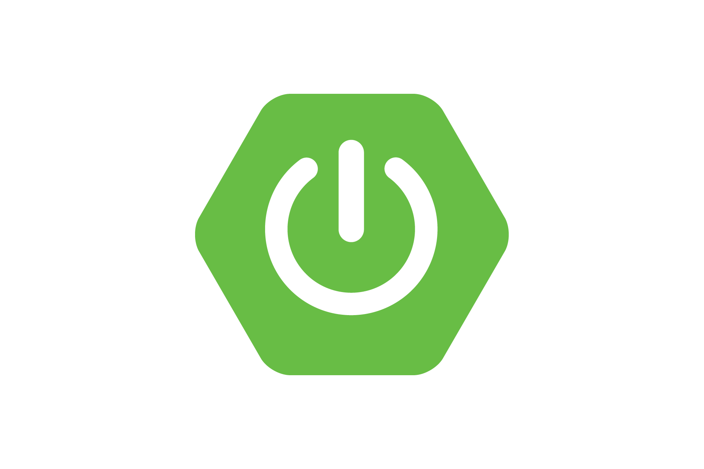
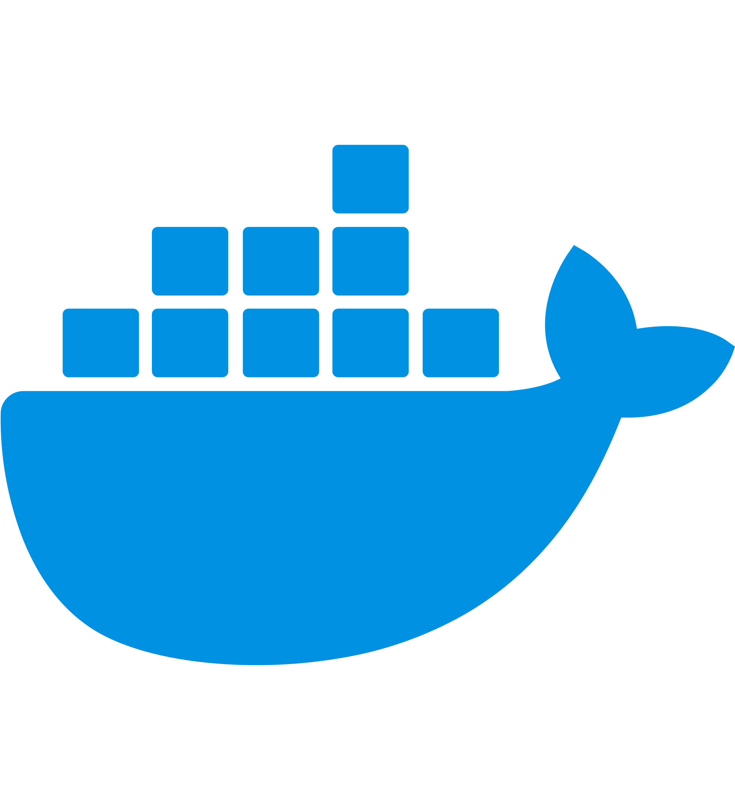

 
  

<!---

  

-->

  

<h1 align="center">
    
</h1>
<h4>I'm a passionate Full Stack Developer from Belgium 🇧🇪 who turns caffeine into clean code. I love bringing ideas to life through code and jumping into projects to help others build awesome things! 🚀</h4>

- 🌱 I’m currently learning **[Java Spring Boot](https://spring.io/projects/spring-boot)**
- 💬 Ask me about **Java, PostGreSQL...or anything [here](https://github.com/LucaClrk/LucaClrk/issues)**

 

  
  
  

## 🚀 Featured Projects

### 💻 [Calibration Application](https://lucaclrk.github.io/projects/calibration-application/)
*The calibration application is an app I made for Advionics NV. This application is a full stack program using PostgreSQL as a database, Python in the backend and mainly HTML for the front-end.*
* **Stack:** Python, HTML, JavaScript, Flask, Ginja, PostgreSQL, Docker, Jenkins
* **Key Feature:** A fully working application build from zero

### 🎹 [Music Light Tile](https://github.com/vives-project-xp/MusicLightTiles)
*A tile that lights up and plays sound when stood upon. From the 3D design to support an 80kg person to the MQTT broker to control the tile through a server. All is explained in the GitHub repository.*
* **Stack:** Python, C++
* **Key Feature:** The combination of software and hardware

### 🏋️ [Fitness Tracker](https://github.com/LucaClrk/lifestyle-tracker)
*A simple web application that helps me maintain my health. You can sync your Garmin data, schedule trainings, add habits...*
* **Stack:** Java, HTML, Spring Boot, PostGreSQL
* **Key Feature:** You can sync your Garmin data

### ⌨️ [Typing Player](https://github.com/LucaClrk/typeplayer)
*A simple typing game.*
* **Stack:**HTML, CSS and JavaScript 
* **Key Feature:** Interactive way to improve your typing skills

## My Productivity Flow
The moment I started getting into computers I've always liked getting into nerdy stuff. Setting up configs for my Neovim, Emacs, Hyprland and so on. You can find all those in my [Dotfiles](http
  * s://github.com/LucaClrk/dotfiles) by the way.

## Emacs

Emacs is the main tool I use for my productivity flow. I get all my needed tools from here. I can access my terminal, calendar, mail, projects... from my emacs setup. 
Having all these things in one place really make it easy for me to work without context switching.

## Neovim

This one isn't a big deal, but it still has a huge impact on how I work. Even though it takes some time to get used too, once you get used to it there's no way you're letting it go.

Using Neovim to edit text is amazing. I use it in Emacs, Intellij, terminal... I use it for all file editing and it is so much smoother

## Tiling manager

As last I will talk about tiling managers. On my work laptop I use <i>Aerospace</i> and on my personal laptop <i>Hyprland</i>. 

Since I've started using tiling managers my workflow has getting much faster and smoother. Having keybinds for all your important application and opening them in specific workspaces

## ⚡️ Stats

 

  

   
  <!-- Unified Streak Stats -->
  

 

### 🛠️ Tech Stack & Tools

| Category | Technologies |
| :--- | :--- |
| **Languages & Backend** |      |
| **Frameworks & Frontend** |        |
| **DevOps & Tools** |       |

## 🐍 My Contributions

  <picture>
    <source media="(prefers-color-scheme: dark)" srcset="https://raw.githubusercontent.com/LucaClrk/LucaClrk/output/github-contribution-grid-snake-dark.svg" />
    <source media="(prefers-color-scheme: light)" srcset="https://raw.githubusercontent.com/LucaClrk/LucaClrk/output/github-contribution-grid-snake.svg" />
    
  </picture>

